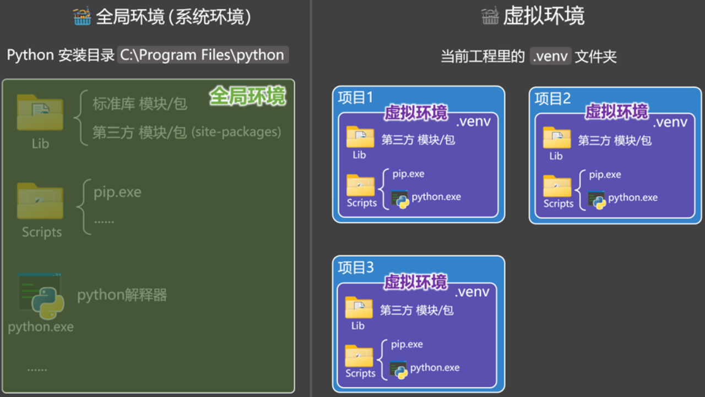

# 1 什么是Python的虚拟环境

一个**项目专属的 Python 运行目录**，包含独立的解释器、`pip` 和第三方包，与系统 Python 及其他项目互不影响。

本质就是一个普通文件夹，不是虚拟机也不是容器：

```text
.venv/
├── bin/            # python、pip、activate（Windows 为 Scripts/）
└── lib/python3.x/  # site-packages：本项目安装的所有依赖
```

激活后 `python` / `pip` 指向该目录，安装的包也只进这里；`deactivate` 即退出。

# 2 为什么Python需要虚拟环境

- **依赖隔离**：项目 A 要 `requests==2.28`、项目 B 要 `2.31`，全局只能装一个版本，虚拟环境各装各的。
- **不污染系统**：`pip install` 默认写入全局 `site-packages`，可能升级掉系统工具依赖的包（Linux/macOS 上的系统 Python 尤其敏感）。
- **可复现**：`requirements.txt` / lock 文件锁定版本，换机器、CI 都能装出同样的环境。
- **免 sudo**：依赖装在项目目录，不需要管理员权限。
- **随手删除**：不用了直接删文件夹，无残留。

类比 Node.js 的 `node_modules`，但 Python 把解释器层面也一起隔离了。

# 3 Python的虚拟环境对应Java中的什么

**没有一一对应**。Java 靠构建工具在编译期解析每条依赖的版本，运行时通过 classpath 加载；Python 的包是直接装进解释器的 `site-packages`，共用同一份，所以必须靠虚拟环境隔离。

| 能力 | Python | Java |
| --- | --- | --- |
| 项目级依赖隔离 | venv / conda / uv 环境 | Maven / Gradle 依赖（classpath） |
| 依赖声明 | `requirements.txt`、`pyproject.toml` | `pom.xml`、`build.gradle` |
| 多版本工具链 | conda、pyenv 切换 Python 版本 | SDKMAN! 切换 JDK |
| 依赖缓存 | pip cache（各环境独立） | `~/.m2` 本地仓库（全局共享） |

最接近的理解：**一个虚拟环境 ≈ 项目专属的 JDK + 独立的 `~/.m2`**；但 Java 有全局仓库做缓存，Python 的隔离粒度更彻底。

# 4 创建 Python 虚拟环境的方式

| 方式 | 定位 | 管理 Python 版本 | 速度 | 适用场景 |
| --- | --- | --- | --- | --- |
| venv | Python 标准库内置 | ❌ | 一般 | 学习、普通项目，零额外依赖 |
| conda | 跨语言包与环境管理器 | ✅ | 较慢 | 数据科学、科学计算、需要非 Python 二进制依赖 |
| uv | Rust 实现的新一代工具 | ✅ | 极快 | 新项目、追求效率，兼容 pip 用法 |

## 4.1 venv

最标准的方式，Python 3.3+ 自带，不需要安装任何东西。

```bash
python3 -m venv .venv             # 创建
source .venv/bin/activate         # 激活（Windows: .venv\Scripts\activate）
pip install -r requirements.txt   # 安装依赖
deactivate                        # 退出
```

- 官方文档：https://docs.python.org/3/library/venv.html
- 安装与使用：https://packaging.python.org/en/latest/guides/installing-using-python-and-virtual-environments/

## 4.2 conda（Anaconda / Miniconda）

**conda** 本身是跨语言的包与环境管理器，能装 Python 包，也能装 Python 之外的二进制库（NumPy、CUDA 等），并同时管理环境和 Python 版本。Anaconda 和 Miniconda 是随 conda 一起分发的两个发行版：

| 发行版 | 内容 | 体积 | 适合 |
| --- | --- | --- | --- |
| Anaconda | conda + Python + 数百个预装科学计算包（Jupyter、pandas 等） | 大（GB 级） | 开箱即用、教学、桌面分析 |
| Miniconda | 只含 conda + Python + pip，其余按需安装 | 小（约 100 MB） | 服务器、CI、想自己控制依赖 |

日常推荐 **Miniconda**：干净、可控，需要什么再装什么。

### 安装 Miniconda（macOS / Linux）

```bash
# 1. 下载安装脚本（macOS Apple Silicon；Intel Mac 用 x86_64，Linux 用 Linux-x86_64）
curl -O https://repo.anaconda.com/miniconda/Miniconda3-latest-MacOSX-arm64.sh
# 2. 执行安装，按提示确认，默认装到 ~/miniconda3
bash Miniconda3-latest-MacOSX-arm64.sh
# 3. 重开终端或 source ~/.zshrc 后验证
conda --version
```

Windows 下载 `.exe` 安装包双击安装，完成后从开始菜单打开 **Anaconda Prompt (miniconda3)** 使用。

### 使用 conda

```bash
conda create -n myenv python=3.11   # 创建环境并指定 Python 版本
conda activate myenv                # 激活
conda install numpy -y              # 安装包
conda list                          # 查看当前环境已装包
conda env list                      # 查看所有环境
conda env export > environment.yml  # 导出环境
conda env create -f environment.yml # 用文件复现环境
conda deactivate                    # 退出
conda env remove -n myenv           # 删除环境
```

> 国内下载慢可配置清华镜像：https://mirrors.tuna.tsinghua.edu.cn/help/anaconda/

- Anaconda 官网：https://www.anaconda.com/
- conda 官方文档：https://docs.conda.io/projects/conda/en/latest/
- Miniconda 介绍：https://docs.conda.io/projects/miniconda/en/latest/
- Miniconda 安装步骤：https://www.anaconda.com/docs/getting-started/miniconda/install
- conda 使用入门：https://docs.conda.io/projects/conda/en/latest/user-guide/getting-started.html

## 4.3 uv

用 Rust 编写的极速 Python 包与项目管理器，可替代 `pip` / `venv` / `pipx`，也能自己下载安装 Python 版本。

```bash
# 安装 uv
curl -LsSf https://astral.sh/uv/install.sh | sh   # macOS / Linux
# Windows: powershell -c "irm https://astral.sh/uv/install.ps1 | iex"

uv venv                  # 创建 .venv
uv pip install requests  # 兼容 pip 用法
uv init myproj           # 或创建带 pyproject.toml 的项目
uv add requests          # 添加依赖并写入 pyproject.toml
uv run main.py           # 自动使用项目环境运行
```

- 官方文档：https://docs.astral.sh/uv/
- 安装步骤：https://docs.astral.sh/uv/getting-started/installation/
- 使用指南：https://docs.astral.sh/uv/guides/projects/
